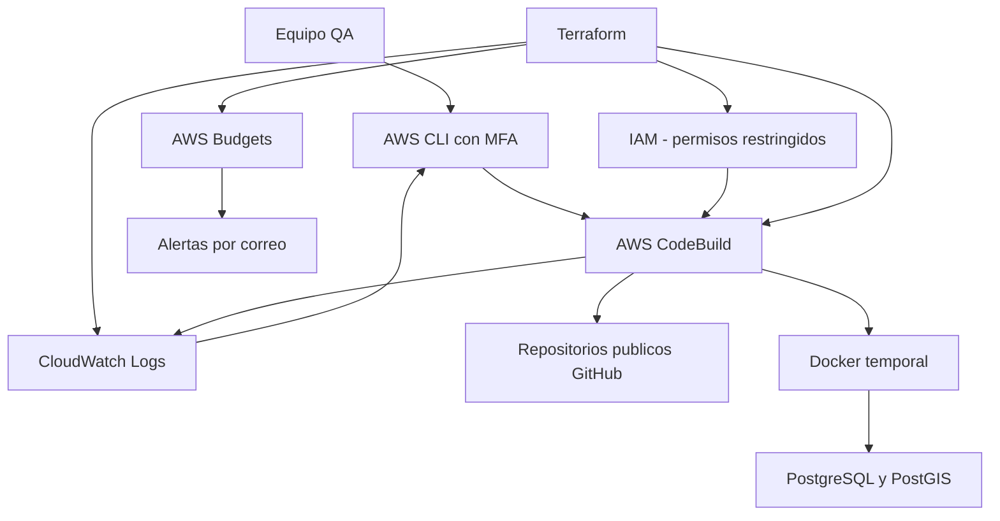

# Entorno de QA remoto - SPA UNAS

## 1. Objetivo

Implementar un entorno de ejecución remota de pruebas de software
mediante AWS CodeBuild, permitiendo al equipo de QA validar los
repositorios de la plataforma SPA UNAS sin depender de la capacidad
de procesamiento de los equipos personales.

La infraestructura se aprovisiona mediante Terraform y utiliza
recursos temporales durante cada ejecución.

## 2. Alcance

El entorno permite ejecutar pruebas sobre los repositorios públicos
de la organización Proyecto-Maestria-Spa-Unas:

- spa-backend-api
- spa-frontend-web
- spa-database

La solución no modifica los entornos de staging o production,
ni los componentes de Kubernetes, Istio o EKS correspondientes
a las actividades DV5 y DV7.

No se aprovisionan instancias EC2, bases de datos RDS ni clústeres
EKS permanentes para esta solución.

## 3. Arquitectura



### 3.1 Componentes

| Componente | Configuración |
|---|---|
| Región AWS | us-east-1 |
| Proyecto CodeBuild | spa-qa-remoto |
| Imagen | aws/codebuild/standard:7.0 |
| Tipo de entorno | LINUX_CONTAINER |
| Capacidad | BUILD_GENERAL1_SMALL |
| Docker privilegiado | Habilitado |
| Python | 3.12 |
| Node.js | 22 |
| PostgreSQL/PostGIS | postgis/postgis:16-3.4 |
| Tiempo máximo configurado | 30 minutos |
| Tiempo máximo en cola configurado | 15 minutos |
| Ejecuciones concurrentes | 1 |
| Retención de logs | 7 días |
| Presupuesto mensual inicial | USD 10 |
| Grupo de logs | /aws/codebuild/spa-qa-remoto |
| Permissions boundary | spa-qa-codebuild-boundary (externo a Terraform) |
| Artefactos persistentes | No configurados |
| Fuente de CodeBuild | NO_SOURCE |

Los valores corresponden a la configuración inicial de Terraform.

El buildspec incorpora los scripts de ejecución mediante Base64.
Esta codificación no constituye un mecanismo de cifrado.

## 4. Responsabilidades

| Actividad | Infraestructura | Equipo QA |
|---|---|---|
| Diseño de arquitectura AWS | Responsable | Consultado |
| Configuración Terraform | Responsable | No aplica |
| Configuración CodeBuild | Responsable | No aplica |
| Configuración IAM | Responsable | Usuario autorizado |
| Control presupuestal | Responsable | Informado |
| Prueba de humo | Responsable | Informado |
| Pruebas unitarias | Soporte | Responsable |
| Pruebas de integración | Soporte | Responsable |
| Análisis de resultados funcionales | Soporte | Responsable |
| Corrección de defectos | Soporte | Equipo de desarrollo |

El responsable de infraestructura valida exclusivamente el
funcionamiento del entorno mediante la prueba de humo.

El responsable de QA, Jhon, ejecutará las pruebas funcionales
después de configurar su MFA y verificar los permisos efectivos. Jhon administra sus propias credenciales y ejecuta las pruebas negativas y funcionales.

## 5. Estructura de archivos

```text
spa-infra-aws/
  buildspecs/
    buildspec.yml
    backend.sh
    database.sh
    frontend.sh
    humo.sh
  docs/
    qa-remoto.md
    qa-remoto-evidencias.md
  scripts/
    qa-remoto.sh
    qa-mfa.sh
  terraform/
    envs/
      qa-remoto/
        versions.tf
        main.tf
        variables.tf
        outputs.tf
        codebuild.tf
        iam.tf
        iam_qa_executor.tf
        cloudwatch.tf
        budgets.tf
        example.tfvars
```

## 6. Requisitos del equipo QA

- AWS CLI versión 2.
- Git y Git Bash para Windows.
- Python 3 disponible desde la terminal.
- Usuario IAM individual autorizado.
- Autenticación multifactor MFA.
- Conexión a Internet.
- Acceso de lectura a los repositorios públicos.

No se requiere instalar Terraform, Docker, PostgreSQL o Node.js
en el equipo personal del responsable de QA para ejecutar
las pruebas remotas.

## 7. Autenticación y configuración de AWS CLI

El flujo acordado en el PR #6 utiliza AWS STS y dos perfiles locales:

| Perfil | Finalidad |
|---|---|
| spa-qa-base | Credencial individual de origen |
| spa-qa | Sesión temporal autenticada con MFA |

### 7.1 Preparación del ejecutor

El administrador entrega la URL de inicio de sesión y la contraseña inicial por un canal privado y seguro. El ejecutor cambia la contraseña en el primer ingreso y registra su propio MFA virtual con el nombre `spa-qa-jhon` desde Credenciales de seguridad. Debe cerrar sesión y volver a ingresar con MFA antes de gestionar sus claves de acceso. El procedimiento detallado de configuración inicial se encuentra en el [README](../README.md).

### 7.2 Sesión desde Git Bash

Seguir el procedimiento de configuración y renovación de los perfiles `spa-qa-base` y `spa-qa` descrito en el README. El script `scripts/qa-mfa.sh` utiliza STS GetSessionToken, solicita una duración de 43200 segundos (12 horas), comprueba la identidad y comunica la expiración. No imprime las credenciales temporales. El código MFA no se muestra al introducirlo.

La configuración local de AWS CLI guarda las credenciales sin cifrado propio. Debe protegerse el equipo y los archivos locales de credenciales; los argumentos de procesos pueden ser visibles localmente. No compartir claves, tokens, códigos MFA ni archivos de credenciales. No ejecutar con trazas de depuración.

La renovación se realiza mediante el mismo procedimiento del README cuando expire la sesión. La comprobación de identidad no demuestra por sí sola que la sesión cumpla las condiciones IAM. La autenticación efectiva y las pruebas de autorización quedan pendientes del ejecutor QA.

## 8. Repositorios y suites disponibles

| Repositorio | unitarias | integracion | todo |
|---|---|---|---|
| spa-backend-api | Sí | Sí | Sí |
| spa-frontend-web | Sí | No | Sí |
| spa-database | No | Sí | Sí |

La suite humo está reservada al responsable de infraestructura
y no está autorizada mediante la política del ejecutor QA.

### 8.1 Backend

La suite unitarias ejecuta:

- Instalación de dependencias Python.
- Ruff check.
- Ruff format en modo verificación.
- Mypy.
- Import Linter.
- Pytest excluyendo el marcador integracion.
- Cobertura mínima del 80 % sobre app.
- Auditoría de dependencias mediante pip-audit.

La suite integracion ejecuta:

- Creación de un contenedor PostgreSQL/PostGIS temporal.
- Descarga del repositorio spa-database desde develop.
- Aplicación del shim de Supabase.
- Aplicación ordenada de migraciones.
- Aplicación del seed cuando exista.
- Verificación de conectividad.
- Ejecución de pruebas con marcador integracion.
- Verificación de que al menos una prueba no fue omitida.
- Eliminación del contenedor y sus volúmenes.

Se registra el commit utilizado del repositorio spa-database.

La dependencia de la rama develop puede afectar la
reproducibilidad entre ejecuciones. Para una reproducibilidad
estricta deberá evaluarse posteriormente fijar un commit
específico de la base de datos.

Las omisiones parciales de pruebas deben ser revisadas por QA.

La suite todo ejecuta ambas suites.

### 8.2 Frontend

Las suites unitarias y todo ejecutan:

- npm ci.
- npm run lint.
- npm run test:ci.
- npm run build.
- npm audit --omit=dev --audit-level=high.

No se identificó una suite de integración independiente
en la configuración CI revisada.

No se impone un umbral adicional de cobertura distinto
al definido por el propio repositorio.

### 8.3 Base de datos

Las suites integracion y todo ejecutan:

- Creación de PostgreSQL/PostGIS temporal.
- Aplicación del shim de Supabase.
- Aplicación ordenada de todas las migraciones.
- Aplicación del seed cuando exista.
- Ejecución de pruebas SQL.
- Segunda aplicación de las migraciones para verificar
  su comportamiento frente a la reejecución.
- Eliminación del contenedor y sus volúmenes.

La segunda aplicación verifica que las migraciones puedan
reejecutarse sin errores SQL. No constituye por sí sola
una demostración completa de idempotencia semántica.

No se utilizan credenciales de Supabase, staging o production.

## 9. Ejecución de pruebas remotas

Desde Git Bash, ubicado en la raíz del repositorio:

```bash
bash scripts/qa-remoto.sh <repo> <ref> <suite>
```

### 9.1 Ejecutar pruebas unitarias del backend

```bash
bash scripts/qa-remoto.sh spa-backend-api develop unitarias
```

### 9.2 Ejecutar pruebas de integración del backend

```bash
bash scripts/qa-remoto.sh spa-backend-api develop integracion
```

### 9.3 Ejecutar todas las pruebas del backend

```bash
bash scripts/qa-remoto.sh spa-backend-api develop todo
```

### 9.4 Ejecutar pruebas del frontend

```bash
bash scripts/qa-remoto.sh spa-frontend-web develop todo
```

### 9.5 Ejecutar pruebas de base de datos

```bash
bash scripts/qa-remoto.sh spa-database develop integracion
```

### 9.6 Evaluar un Pull Request

Ejemplo para el Pull Request número 15:

```bash
bash scripts/qa-remoto.sh spa-backend-api pull/15/head todo
```

El número del Pull Request es ilustrativo y deberá
reemplazarse por el correspondiente.

### 9.7 Evaluar un commit específico

```bash
bash scripts/qa-remoto.sh spa-backend-api <SHA-DE-40-CARACTERES> todo
```

El SHA deberá reemplazarse por un identificador real.

## 10. Resultados y códigos de salida

El script consulta el estado de CodeBuild y muestra los
eventos disponibles de CloudWatch Logs en la terminal.

| Estado | Código de salida |
|---|---|
| SUCCEEDED | 0 |
| FAILED | 1 |
| FAULT | 1 |
| TIMED_OUT | 1 |
| STOPPED | 1 |
| Interrupción mediante Ctrl+C | 130 |

La interrupción mediante Ctrl+C solicita la cancelación
de la ejecución remota.

Si la solicitud de cancelación falla, el proceso remoto
podría continuar. Se deberá verificar su estado en AWS.

La transmisión de logs es de mejor esfuerzo. Una ejecución
puede finalizar correctamente aunque algunos eventos
no hayan podido recuperarse en la terminal.

El resultado de CodeBuild constituye la referencia
principal del estado de ejecución.

## 11. Prueba de humo de infraestructura

La prueba de humo verifica:

1. Python 3.12.
2. Node.js 22 y npm.
3. Git y disponibilidad efectiva del motor Docker.
4. Inicio de un contenedor PostgreSQL/PostGIS.
5. Conectividad TCP y consultas PostgreSQL.
6. Disponibilidad de la extensión PostGIS.
7. Ejecución de una consulta espacial.
8. Eliminación del contenedor y sus volúmenes.

Resultado obtenido el 24 de noviembre de 2026 (71 segundos):

```text
INFRASTRUCTURE SMOKE TEST: PASSED
```

CloudWatch confirmó Python 3.12.16, Node.js 22.23.4, npm 11.21.1,
Git 2.56.0, Docker 29.9.2, PostgreSQL 16.4 y PostGIS 3.4.3.
La consulta espacial devolvió POINT(1 2) y se confirmó la limpieza
del contenedor y sus volúmenes. Docker informó una advertencia sobre
su API local sin cifrado y la obsolescencia de cgroup v1.

La prueba de humo no ejecuta pruebas funcionales
de los repositorios de aplicación.

Su ejecución está reservada al responsable de infraestructura.

## 12. Seguridad e IAM

### 12.1 Rol de servicio CodeBuild

Nombre:

```text
spa-qa-remoto-codebuild-role
```

El rol dispone de permisos para crear streams y escribir
eventos en el grupo de logs asignado al proyecto.

La relación de confianza restringe la asunción del rol
al servicio CodeBuild, la cuenta AWS y el proyecto definido.

No se conceden permisos para acceder a bases de datos reales,
Secrets Manager, S3, EKS o recursos de producción.

#### Límite de permisos del rol de servicio

El administrador de AWS creó manualmente la política administrada
por el cliente `spa-qa-codebuild-boundary`. Terraform la referencia
mediante `permissions_boundary` en `iam.tf`, construyendo el ARN con
la partición y la cuenta actuales.

La política limita los permisos de identidad del rol a las dos
operaciones de escritura de logs. No concede permisos por sí sola:
los permisos efectivos de identidad requieren autorización tanto
por la política del rol como por el límite.

Plantilla JSON para la región us-east-1 (sustituir ACCOUNT_ID por
la cuenta de destino antes de crear la política):

```json
{
  "Version": "2012-10-17",
  "Statement": [
    {
      "Sid": "AllowOnlyQALogWrites",
      "Effect": "Allow",
      "Action": ["logs:CreateLogStream", "logs:PutLogEvents"],
      "Resource": "arn:aws:logs:us-east-1:ACCOUNT_ID:log-group:/aws/codebuild/spa-qa-remoto:*"
    }
  ]
}
```

El sufijo `:*` fue adoptado tras una advertencia del resumen visual
IAM con el formato anterior `:log-stream:*`. El documento actualizado
superó Access Analyzer y ocho evaluaciones de simulación.

El límite debe permanecer bajo control administrativo independiente.
El usuario de aprovisionamiento no debe poder modificarlo, eliminarlo
ni retirar el límite del rol. La verificación efectiva queda pendiente.

### 12.2 Política del ejecutor QA

Nombre:

```text
spa-qa-ejecutor
```

Permisos operativos:

| Acción | Alcance |
|---|---|
| codebuild:StartBuild | Proyecto spa-qa-remoto |
| codebuild:BatchGetBuilds | Proyecto spa-qa-remoto |
| codebuild:StopBuild | Proyecto spa-qa-remoto |
| logs:FilterLogEvents | Grupo de logs QA |
| logs:GetLogEvents | Streams del grupo QA |

La política exige MFA y establece restricciones sobre
los repositorios, suites y parámetros de ejecución.

No concede iam:PassRole ni permisos de administración
de infraestructura.

### 12.2.1 Aprovisionamiento administrativo del ejecutor

El administrador realizó la configuración fuera de Terraform, por lo que estos elementos no forman parte de los seis recursos del plan:

- Grupo `spa-qa-executors` con la política `spa-qa-ejecutor`.
- Usuario individual `spa-qa-jhon`, miembro del grupo.
- Acceso inicial a consola con cambio obligatorio de contraseña y política `IAMUserChangePassword`.
- Política individual insertada `spa-qa-self-management`, limitada al usuario propietario para el registro MFA y la gestión de claves propias.
- Retiro de `SignInLocalDevelopmentAccess` del grupo QA, al adoptarse STS.

El administrador no genera claves de acceso ni registra el dispositivo MFA del ejecutor. La contraseña inicial debe entregarse en privado. El ejecutor registra su MFA y administra sus propias claves. La política exige MFA para crear, listar y actualizar claves; no concede eliminación de claves ni desactivación del MFA. La recuperación del dispositivo corresponde al administrador. El listado de dispositivos MFA virtuales tiene alcance de cuenta. Los permisos efectivos aún no se han comprobado con la sesión del ejecutor.

La configuración administrativa debe conservarse bajo control del administrador autorizado y revisarse antes de reproducirla en otra cuenta.

#### Politica IAM de autogestion

La siguiente politica individual, denominada `spa-qa-self-management`,
fue configurada por el administrador directamente sobre el usuario IAM.

Para reproducir la configuracion:

1. Crear el grupo `spa-qa-executors`.
2. Asociar al grupo la politica `spa-qa-ejecutor`.
3. Crear el usuario individual `spa-qa-jhon`.
4. Habilitar el acceso a consola con cambio obligatorio de contrasena.
5. Incorporar el usuario al grupo.
6. Verificar la asignacion de `IAMUserChangePassword`.
7. Desde los permisos del usuario, crear una politica insertada
   utilizando el siguiente documento JSON.
8. Guardar la politica con el nombre `spa-qa-self-management`.

```json
{
  "Version": "2012-10-17",
  "Statement": [
    {
      "Sid": "AllowReadAccountPasswordPolicy",
      "Effect": "Allow",
      "Action": "iam:GetAccountPasswordPolicy",
      "Resource": "*"
    },
    {
      "Sid": "AllowListVirtualMFADevices",
      "Effect": "Allow",
      "Action": "iam:ListVirtualMFADevices",
      "Resource": "*"
    },
    {
      "Sid": "AllowCreateOwnVirtualMFA",
      "Effect": "Allow",
      "Action": "iam:CreateVirtualMFADevice",
      "Resource": "arn:aws:iam::*:mfa/${aws:username}"
    },
    {
      "Sid": "AllowEnableAndReadOwnMFA",
      "Effect": "Allow",
      "Action": [
        "iam:GetUser",
        "iam:EnableMFADevice",
        "iam:ListMFADevices"
      ],
      "Resource": "arn:aws:iam::*:user/${aws:username}"
    },
    {
      "Sid": "AllowManageOwnAccessKeysWithMFA",
      "Effect": "Allow",
      "Action": [
        "iam:CreateAccessKey",
        "iam:ListAccessKeys",
        "iam:UpdateAccessKey"
      ],
      "Resource": "arn:aws:iam::*:user/${aws:username}",
      "Condition": {
        "Bool": {
          "aws:MultiFactorAuthPresent": "true"
        }
      }
    }
  ]
}
```

Consideraciones:

- La variable `${aws:username}` limita las operaciones sobre
  usuarios y dispositivos MFA al nombre del usuario autenticado.
- El dispositivo MFA virtual debe llamarse `spa-qa-jhon`.
- La creacion, consulta y actualizacion de claves requiere MFA.
- La actualizacion permite activar o desactivar claves propias.
- No se concede permiso para eliminar claves de acceso.
- No se concede permiso para desactivar dispositivos MFA.
- La consulta de la politica de contrasenas y el listado de
  dispositivos MFA virtuales tienen alcance de cuenta.
- La politica no contiene credenciales ni secretos.
- El administrador no debe generar las claves del ejecutor QA.
- La recuperacion de acceso corresponde al administrador autorizado.

La configuracion efectiva de MFA y la gestion de claves deben
ser verificadas por el ejecutor QA durante su primer acceso.

### 12.3 Protección de información

- No utilizar secretos de staging o production.
- No utilizar credenciales reales de Supabase.
- No incluir claves AWS en variables de CodeBuild.
- No almacenar secretos en scripts o documentación.
- No publicar archivos de estado Terraform.
- No publicar archivos de variables privadas.
- No publicar planes Terraform binarios.
- No ejecutar código de procedencia desconocida.

Las contraseñas y valores JWT empleados por los scripts
son exclusivamente valores ficticios para pruebas locales
dentro del entorno temporal.

## 13. Riesgos residuales y decisión de arquitectura

Se seleccionó la opción A: acceso directo restringido
mediante IAM a AWS CodeBuild, sin intermediario Lambda.

Esta decisión reduce la complejidad de implementación,
pero conserva riesgos residuales.

| Riesgo | Mitigación | Estado |
|---|---|---|
| Modificación del buildspec | Restricciones IAM disponibles | Validación local |
| Selección de repositorio no autorizado | Restricciones IAM y dispatcher | Validación local |
| Ejecución de suite humo por QA | Restricción IAM | Validación local |
| Modificación de capacidad de cómputo | Restricciones IAM | Validación local |
| Overrides sin condición IAM específica identificada | Revisión y supervisión | Riesgo residual |
| Ejecución de código no confiable | Revisión previa y rol mínimo | Riesgo residual |
| Docker privilegiado | Entorno temporal y rol mínimo | Riesgo residual |
| Consumo superior al presupuesto | Alertas y concurrencia | Riesgo residual |

No se identificaron condiciones IAM específicas para
todos los parámetros de StartBuild, incluidos determinados
overrides de tiempo de ejecución y opciones de depuración.

Tampoco se ha demostrado que todos esos parámetros
puedan modificarse efectivamente bajo la política propuesta.

El dispatcher valida los parámetros recibidos, pero no
constituye una frontera de seguridad independiente de IAM.

Las simulaciones IAM utilizan valores de contexto
proporcionados manualmente. Por tanto, no sustituyen
las pruebas de autorización efectivas en AWS.

La ejecución de código de ramas o Pull Requests puede
ejecutar código arbitrario dentro del entorno de compilación,
incluidas comunicaciones salientes.

El entorno no constituye un aislamiento de seguridad
suficiente para ejecutar código deliberadamente hostil.

El PO aceptó expresamente los riesgos residuales en la revisión del [PR #6](https://github.com/Proyecto-Maestria-Spa-Unas/spa-infra-aws/pull/6). La infraestructura ya fue validada mediante la prueba de humo. Permanecen pendientes la configuración individual de MFA y la verificación efectiva de IAM por Jhon. La aceptación de riesgos no convierte el presupuesto ni el timeout configurado en límites absolutos.

Si se requiere controlar estrictamente todos los parámetros
de StartBuild, deberá evaluarse la opción B mediante un
intermediario que valide las solicitudes y no permita
acceso directo a StartBuild por parte de QA.

## 14. Control de costos

La configuración inicial establece:

- Presupuesto mensual de USD 10.
- Alertas de consumo al 50 %, 80 % y 100 %.
- Una ejecución concurrente.
- Tiempo de ejecución configurado de 30 minutos.
- Retención de logs de siete días.
- Exclusión de créditos en el cálculo del presupuesto.

| Umbral | Valor inicial |
|---|---|
| 50 % | USD 5 |
| 80 % | USD 8 |
| 100 % | USD 10 |

El presupuesto se configura a nivel de cuenta AWS,
sin un filtro exclusivo para el proyecto QA.

AWS Budgets genera alertas y no constituye un límite
automático de consumo.

El tiempo de ejecución configurado tampoco constituye
una garantía absoluta frente a todos los overrides.

El consumo depende del tiempo de compilación, los logs,
las condiciones de la cuenta y las tarifas vigentes.

Antes de desplegar se deberá verificar la disponibilidad
de créditos y las restricciones del plan AWS.

No se deberá actualizar la cuenta a un plan de pago
sin autorización expresa.

## 15. Despliegue mediante Terraform

Esta sección está reservada al responsable de infraestructura.

### 15.1 Requisitos

- Terraform 1.9 o superior.
- AWS CLI v2.
- Credenciales autorizadas de despliegue.
- Autenticación MFA.
- Permisos limitados de aprovisionamiento.
- Política administrada `spa-qa-codebuild-boundary` creada previamente
  por un administrador, según la sección 12.1.

La política externa no pertenece al estado Terraform de QA remoto.
Terraform no la crea ni la elimina. Debe existir en la cuenta de destino
antes del despliegue. La política documentada corresponde a us-east-1;
si cambia la región, el administrador deberá adaptar y revalidar su ARN
de recurso antes de desplegar.

### 15.2 Configuración

Desde PowerShell:

```powershell
Set-Location .\terraform\envs\qa-remoto
Copy-Item .\example.tfvars .\terraform.tfvars
```

Editar terraform.tfvars y configurar el correo real
para las alertas presupuestales.

No publicar terraform.tfvars.

### 15.3 Validación

```powershell
terraform init
terraform fmt -check
terraform validate
```

### 15.4 Plan de infraestructura

```powershell
$env:AWS_PROFILE = "spa-infra-deployer"
$env:AWS_SDK_LOAD_CONFIG = "1"
terraform plan -no-color "-out=qa-remoto.tfplan"
```

La compatibilidad de las credenciales temporales del perfil
con el proveedor Terraform deberá verificarse previamente.

Revisar el plan y confirmar que solamente se aprovisionan
los recursos correspondientes a QA remoto.

### 15.5 Aprovisionamiento

Después de revisar y aprobar el plan:

```powershell
terraform apply "qa-remoto.tfplan"
```

No ejecutar este comando sobre staging o production.

### 15.6 Verificación

```powershell
terraform output
```

Verificar el proyecto CodeBuild, el grupo de logs,
el presupuesto y los recursos IAM creados.

### 15.7 Estado Terraform

Inicialmente se utiliza estado local independiente.

El archivo de estado debe mantenerse protegido y no
publicarse en GitHub.

La migración a un backend remoto deberá coordinarse
con el equipo de infraestructura.

## 16. Solución de problemas

| Problema | Acción recomendada |
|---|---|
| AccessDenied | Verificar sesión MFA, permisos y perfil |
| ExpiredToken | Renovar la sesión temporal según el README |
| Repositorio inválido | Revisar los nombres autorizados |
| Suite no soportada | Consultar la matriz de suites |
| Referencia Git inválida | Verificar rama, PR o SHA |
| Fallo al descargar dependencias | Revisar logs y conectividad |
| PostgreSQL no disponible | Revisar logs del contenedor |
| Cobertura inferior al 80 % | Reportar al equipo de desarrollo |
| TIMED_OUT | Revisar duración y alcance de las pruebas |
| Logs incompletos | Consultar CloudWatch Logs |
| Ejecución interrumpida | Confirmar estado remoto en AWS |

## 17. Evidencias y estado de implementación

| Validación | Estado |
|---|---|
| Configuración Terraform | Implementada |
| Terraform init local | PASS |
| Terraform validate local | PASS |
| Sintaxis Bash | PASS |
| Estructura YAML del dispatcher | PASS |
| Incorporación de scripts Base64 | PASS |
| Tamaño del buildspec | 19632 caracteres |
| Aceptación del buildspec por AWS | PASS |
| Validación IAM Access Analyzer | Sin hallazgos reportados |
| Simulación IAM sin MFA | Denegación verificada |
| Simulación IAM con parámetros autorizados | PASS |
| Simulación IAM con parámetros inválidos | Denegación verificada |
| Validación local de argumentos CLI | PASS |
| Paginación simulada de logs | PASS |
| Códigos de salida simulados | PASS |
| Solicitud simulada de cancelación | PASS |
| Permissions boundary: Access Analyzer | Sin hallazgos |
| Permissions boundary: escritura de logs QA | 2 de 2 PASS |
| Permissions boundary: escritura de logs externos | 2 de 2 denegaciones esperadas |
| Permissions boundary: IAM, S3, Secrets Manager y EC2 | 4 de 4 denegaciones esperadas |
| Política externa spa-qa-codebuild-boundary | Creada manualmente |
| Referencia del límite en iam.tf | Implementada |
| Terraform fmt y validate tras incorporar el límite | PASS |
| Aplicación efectiva del límite al rol AWS | Apply exitoso; pruebas negativas reales pendientes |
| Terraform plan contra AWS | 6 to add, 0 to change, 0 to destroy |
| Terraform apply | 6 added, 0 changed, 0 destroyed |
| Prueba de humo efectiva en AWS | SUCCEEDED |
| Registros CloudWatch y limpieza temporal | PASS |
| Retiro de permisos temporales de aprovisionamiento | Completado el 2026-11-24 |
| Usuario IAM y asignación de política QA | Configurados |
| Política individual de autogestión | Creada |
| Aceptación de riesgos residuales | Aprobada por PO |
| Script qa-mfa.sh | Creado; sintaxis Bash PASS |
| Activación MFA y sesión STS del ejecutor | Pendiente |
| Pruebas negativas reales | Pendiente |
| Autorización efectiva del usuario QA | Pendiente |
| Ejecución funcional por QA | Pendiente |
| Pull Request hacia develop | PR #6 creado; checks iniciales 3/3 exitosos; revisión pendiente de cierre |

Las validaciones locales no constituyen evidencia de
ejecución efectiva en AWS.

Los resultados del despliegue y de la prueba de humo están registrados
en [Evidencias de validación](qa-remoto-evidencias.md).
La autorización efectiva del ejecutor QA y las pruebas funcionales siguen pendientes.

## 18. Criterios de aceptación

- Infraestructura QA independiente de staging y production.
- Terraform plan revisado y aprobado.
- Terraform apply exitoso.
- Proyecto CodeBuild operativo.
- Prueba de humo exitosa.
- Logs disponibles en CloudWatch.
- Presupuesto y alertas configurados.
- Permisos QA restringidos y verificados.
- Autenticación MFA comprobada.
- Riesgos residuales aprobados por el grupo.
- Documentación técnica disponible.
- Pull Request hacia develop con evidencias sanitizadas.
- Pruebas negativas reales por el ejecutor: sin MFA, intento de override del buildspec, repositorio no autorizado y suite humo. Resultado esperado: AccessDenied. No se han ejecutado todavía.
- Primera ejecución funcional de los tres repositorios por Jhon y registro de resultados para la aceptación del issue #5.

## 19. Referencias oficiales

- AWS CodeBuild:
  https://docs.aws.amazon.com/codebuild/

- AWS CodeBuild buildspec:
  https://docs.aws.amazon.com/codebuild/latest/userguide/build-spec-ref.html

- AWS CodeBuild runtimes:
  https://docs.aws.amazon.com/codebuild/latest/userguide/available-runtimes.html

- AWS IAM:
  https://docs.aws.amazon.com/IAM/latest/UserGuide/

- AWS CloudWatch Logs:
  https://docs.aws.amazon.com/AmazonCloudWatch/latest/logs/

- AWS Budgets:
  https://docs.aws.amazon.com/cost-management/latest/userguide/budgets-managing-costs.html

- Terraform AWS Provider:
  https://registry.terraform.io/providers/hashicorp/aws/latest/docs

## 20. Control de cambios

Rama de implementación:

```text
feature/qa-remoto
```

Rama destino:

```text
develop
```

La implementación no modifica los componentes asociados
a DV5 ni DV7.

Las evidencias del despliegue se encuentran en
[qa-remoto-evidencias.md](qa-remoto-evidencias.md).
El retiro de permisos temporales se completó el 24 de noviembre de 2026. El [PR #6](https://github.com/Proyecto-Maestria-Spa-Unas/spa-infra-aws/pull/6) fue creado hacia develop. Las correcciones de la revisión se incorporan al mismo PR, asociado al [issue #5](https://github.com/Proyecto-Maestria-Spa-Unas/spa-infra-aws/issues/5). La aceptación definitiva sigue pendiente de las validaciones de QA.
